  

  
  

<i>I turn paper-based, manual processes into reliable, automated systems, from forms and databases to dashboards and AI agents.</i>

---

## 👋 About me

<table>
  <tr>
    <td width="50%" valign="top">

**🎓 Education**
- **M.Sc. Medical Informatics**, Tehran University of Medical Sciences *(current)*
- **B.Sc. Health Information Technology**, Kerman University of Medical Sciences

**💼 Right now**
- Building an **ERP system** for **Imam Khomeini Hospital Complex** and the **Iranian Tissue Products Research Center**, Tehran
- ✅ The **planning module is complete**

</td>
    <td width="50%" valign="top">

**💡 What I love building**
- 🤖 AI-powered tools and **chatbots**
- ⚙️ **Automation** that removes repetitive manual work
- 🏥 Software that makes healthcare safer and simpler

**📖 Favorite journal**
- **JAMIA** — *Journal of the American Medical Informatics Association*

</td>
  </tr>
</table>

> 💻 I'm married to my laptop. Being apart from it is harder than anything else.
> 🚀 I'm in love with new technology. AI and how fast it grows both excite me and scare me a little.

---

## 🧩 Projects

<table>
  <tr>
    <td width="50%" valign="top">
      <h3>🚑 <a href="https://github.com/reza1eram/VoxPCR">VoxPCR</a></h3>
      Open-source voice-to-report system for pre-hospital EMS. Medics dictate; speech becomes structured, NEMSIS-based data; a human approves; every AI step is traceable.  
      <code>PHP</code> <code>MySQL</code> <code>Python</code> <code>LLM</code> <code>RAG</code>
    </td>
    <td width="50%" valign="top">
      <h3>🧬 <a href="https://github.com/reza1eram/PeyvandProject-showcase">Tissue Products ERP</a></h3>
      Daily production reports for 16 stations, supervisor approval, bottleneck dashboards (Pareto), weekly planning and donor-code tracking for a transplant tissue products center.  
      <code>PHP</code> <code>MySQL</code> <code>Chart.js</code>
    </td>
  </tr>
  <tr>
    <td width="50%" valign="top">
      <h3>🥗 <a href="https://github.com/reza1eram/diet-platform-showcase">Combined Diet Platform</a></h3>
      Diet planning on modern nutrition and traditional Iranian medicine (mizaj), with an agentic AI assistant fenced by a SQL allow-list and per-user token metering.  
      <code>PHP</code> <code>MySQL</code> <code>LLM</code> <code>SSE</code>
    </td>
    <td width="50%" valign="top">
      <h3>💬 <a href="https://github.com/reza1eram/hamrah-crisis-assistant">Hamrah</a></h3>
      Persian RAG chatbot for crisis and emergency self-care, grounded only in official Ministry of Health documents, with cited sources.  
      <code>Python</code> <code>RAG</code> <code>Hybrid retrieval</code>
    </td>
  </tr>
  <tr>
    <td colspan="2" valign="top">
      <h3>📊 <a href="https://github.com/reza1eram/SalesManagement-Overview">Sales Management</a></h3>
      Sales and invoicing software for door and window manufacturers, developed and supported since 2023.
      <code>C#</code> <code>SQL Server</code>
    </td>
  </tr>
</table>

---

## 🛠️ Tools I work with

  
  
  
  
  
  
  
  
  
  
  
  

---

## 🌸 Beyond the screen

  

| | |
|---|---|
| 🌷 | The smell of flowers, potted plants, trees and their leaves |
| 🦋 | Butterflies and pigeons in flight |
| 🐱 | Little kittens |
| 😄 | The sound of people laughing; it calms me |
| 🧸 | Kids, and playing and spending time with them |

---

## 🇮🇷 درباره‌ی من

**🎓 تحصیلات**
- دانشجوی **کارشناسی ارشد انفورماتیک پزشکی**، **دانشگاه علوم پزشکی تهران**
- کارشناسی از **دانشگاه علوم پزشکی کرمان**

**💼 کار فعلی**
- توسعه‌ی **نرم‌افزار ERP** در **مجتمع بیمارستانی امام خمینی تهران** و **مرکز تحقیقات فراورده‌های بافت پیوندی ایران**
- ✅ **ماژول برنامه‌ریزی** این نرم‌افزار به مرحله‌ی تکمیل رسیده است.

**💡 علایق کاری**
- به پروژه‌های **اتوماسیون**، **هوش مصنوعی** و **چت‌بات‌ها** علاقه دارم.
- از استفاده‌ی هوش مصنوعی در کارها و زندگی‌ام لذت می‌برم.
- 💻 با لپ‌تاپم ازدواج کرده‌ام و جدایی از آن برایم سخت‌تر از هر چیزی است.
- 🚀 عاشق تکنولوژی‌های جدیدم. از هوش مصنوعی و رشد سریعش هم لذت می‌برم و هم می‌ترسم.
- 📖 مجله‌ی مورد علاقه‌ام در رشته‌ی خودم: **مجله‌ی انفورماتیک پزشکی آمریکا (JAMIA)**

**🌸 چیزهای کوچک زندگی**
- 🌷 بوی گل‌ها، گلدان‌ها، درخت‌ها و برگ‌هایشان
- 🦋 پرواز پروانه‌ها و کبوترها
- 🐱 گربه‌های کوچک
- 😄 صدای خندیدن آدم‌ها، که برایم آرامش‌بخش است
- 🧸 بچه‌ها، و بازی کردن و وقت گذراندن با آن‌ها

**🔗 راه‌های ارتباط**
- 🌐 وب‌سایت شخصی (فارسی): [me.reza-eram.ir](https://me.reza-eram.ir)
- ✈️ تلگرام: [alireza_er4m@](https://t.me/alireza_er4m)

---

Thanks for stopping by. Have a beautiful day 🌼

